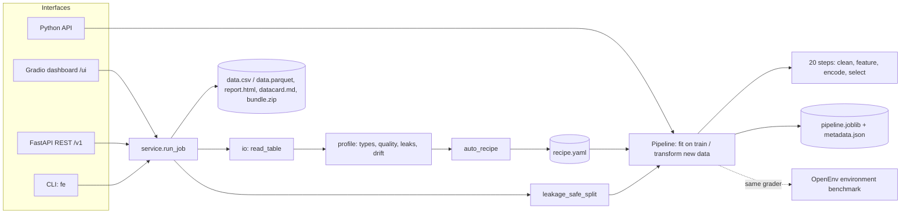
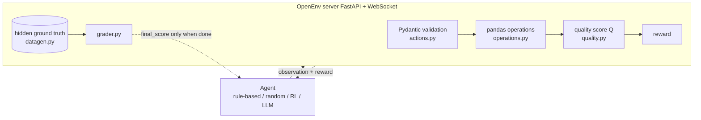

# FeatureForge

**Upload a messy table, get back a clean, feature-engineered dataset, plus the pipeline that made it.**

FeatureForge profiles tabular data (CSV, TSV, Excel, Parquet, JSON), finds quality problems and target leaks, cleans
the data, engineers features, and saves everything as a reproducible recipe that can be re-applied to new data. It
ships as a Python library, a web dashboard, a REST API and a CLI. The project also contains the
[OpenEnv data-cleaning environment](#the-openenv-data-cleaning-environment) (with RL, LLM and rule-based agents) that
it grew out of, which is used as an independent benchmark for the cleaning part.

- **One click or full control.** Auto mode builds a recipe from the data; every step is a plain, editable YAML entry.
- **Leakage-safe by construction.** Every statistic is learned with `fit` on training data and replayed with
  `transform`; target encoding is out-of-fold; the train/test split keeps duplicates and groups on one side; columns
  that leak the target are flagged and dropped by auto mode.
- **Reproducible artifacts.** `recipe.yaml` + `pipeline.joblib` + `metadata.json`, an HTML quality report and a
  dataset card (Datasheets for Datasets) for every run.
- **Research-based.** Each technique is tied to its paper in [docs/RESEARCH.md](docs/RESEARCH.md); every source is
  listed in [docs/references/INDEX.md](docs/references/INDEX.md). The PDF and web-page copies are local only (not in
  this repository); `python scripts/fetch_references.py` downloads them into `docs/references/`.

## What it does

| Area | Capabilities |
|---|---|
| **Read** | CSV / TSV (delimiter + encoding detection), Excel `.xlsx`, Parquet, JSON, JSON Lines, Feather; size limit, clear errors |
| **Understand** | semantic type inference (numeric, categorical, datetime, text, ID, boolean, constant), even when numbers/dates are stored as text |
| **Profile** | missingness, duplicates, cardinality, skew, IQR outliers, correlations, placeholders (`N/A`, `-`, `?`), case/spacing variants, class imbalance, target association (normalised MI), **leak detection** (column equal to / determining the target, ID columns), drift between two tables (PSI + KS test), 0-100 quality score; sampling for large files |
| **Clean** | drop unusable columns, string normalisation + variant merging, type fixing (`"$1,250.00"`, `"45%"`, mixed date formats, yes/no), deduplication, imputation (median / mean / KNN / iterative-MICE / constant) with missing-indicator flags, outliers (IQR, MAD, z-score, quantile winsorising, explicit bounds, Isolation Forest) |
| **Engineer** | datetime parts + cyclical sin/cos + elapsed time, log1p / Yeo-Johnson / quantile bins, scaling, pairwise interactions, group aggregations (DFS-style), text statistics + TF-IDF (+SVD), one-hot (top-k + other), frequency, ordinal, smoothed out-of-fold / ordered target encoding |
| **Select** | variance filter, correlation pruning (keeps the more informative column), mutual-information selection, OpenFE-style candidate generation (MI screen + residual boosting) |
| **Ship** | engineered dataset (CSV + Parquet), test split output, fitted pipeline, recipe, HTML report, dataset card, run summary, one zip bundle |

20 pipeline steps in total: `fe steps` lists them with their parameters.

## Architecture



`featureforge/` is a pure library (no UI imports); the dashboard, API and CLI are thin layers over
`featureforge.service.run_job`.

## Quick start (Windows PowerShell)

Python 3.10+ is required.

```powershell
git clone https://github.com/chetangadhiya5062/open-env-nuclei.git
cd open-env-nuclei
python -m venv .venv
.\.venv\Scripts\Activate.ps1
pip install -e ".[dev]"
```

**Dashboard + API** (open <http://localhost:8000/ui>, API docs at <http://localhost:8000/docs>):

```powershell
fe serve --port 8000
```

Tabs: **1 Data** (upload or load a sample, choose the target, or press *One-click auto*) → **2 Profile** (quality score,
findings, charts, per-column detail, HTML report) → **3 Pipeline** (generate a clean / standard / full recipe, untick
or edit steps, optional leakage-safe split, run, step report, before/after per column) → **4 Export** (dataset,
pipeline, recipe, report, dataset card, zip) → **5 Apply** (run the fitted pipeline on new data, with drift check).

**CLI:**

```powershell
fe sample churn --rows 5000 --out churn.csv                       # a messy demo table
fe profile churn.csv --target churned --out report.html            # quality report
fe auto churn.csv --target churned --level standard --out recipe.yaml
fe run churn.csv --recipe recipe.yaml --out-dir out                # or without --recipe: auto mode
fe run churn.csv --target churned --test-size 0.2 --out-dir out    # leakage-safe split, fit on train only
fe transform new_customers.csv --pipeline out/pipeline --out new_features.parquet
fe drift churn.csv new_customers.csv
```

**Python:**

```python
from featureforge import Pipeline, auto_recipe, profile, read_table

df = read_table("churn.csv")
report = profile(df, target="churned")  # dict: dataset, columns, warnings, quality_score, ...
pipe = Pipeline(auto_recipe(df, target="churned", level="standard"))
features = pipe.fit_transform(df)
pipe.save("artifacts/churn")  # recipe.yaml + pipeline.joblib + metadata.json
new = Pipeline.load("artifacts/churn").transform(read_table("new_customers.csv"))
```

**REST API:**

```powershell
curl.exe -F "file=@churn.csv" -F "target=churned" -F "test_size=0.2" http://localhost:8000/v1/runs
curl.exe -o data.parquet http://localhost:8000/v1/runs/<run_id>/files/data.parquet
curl.exe -F "file=@new_customers.csv" -o out.csv http://localhost:8000/v1/runs/<run_id>/transform
```

| Endpoint | Purpose |
|---|---|
| `GET /health`, `GET /v1/info`, `GET /v1/steps` | liveness, limits/formats, step catalog with JSON schemas |
| `POST /v1/profile` | profile an upload |
| `POST /v1/recipes/auto`, `POST /v1/recipes/validate` | generate / validate a recipe |
| `POST /v1/runs` | full run (auto or given recipe, optional split); returns the summary |
| `GET /v1/runs`, `GET /v1/runs/{id}`, `GET /v1/runs/{id}/files/{name}` | list runs, summary, download artifacts |
| `POST /v1/runs/{id}/transform` | apply that run's fitted pipeline to new data |

**Docker:**

```powershell
docker compose up --build          # FeatureForge on :8000 (/ui, /docs) and the OpenEnv environment on :7860
```

### Recipes

```yaml
version: 1
name: churn-prep
target: churned
task: auto                 # auto | classification | regression | none
id_columns: [customer_id]  # kept, never used as features
type_overrides: {zip_code: categorical}
steps:
  - step: drop_columns
    params: {columns: [cancellation_reason]}
  - step: normalize_strings
  - step: fix_types
  - step: deduplicate        # train-only: never removes rows from new data
  - step: impute
    params: {numeric_strategy: knn, add_indicator: true}
  - step: datetime_features
  - step: target_encode
    params: {columns: [city], smoothing: 10, scheme: oof}
  - step: one_hot
    params: {max_categories: 15}
```

### Settings

Environment variables (see `.env.example`): `FF_WORK_DIR`, `FF_MAX_UPLOAD_MB` (200), `FF_PROFILE_SAMPLE_ROWS` (50,000),
`FF_MAX_FIT_ROWS` (20,000, cap for KNN/iterative imputation, Isolation Forest, MI and generation), `FF_PREVIEW_ROWS`,
`FF_LOG_LEVEL`, `FF_RUN_TTL_HOURS`, `FF_API_KEY` (if set, `/v1` requires the `X-API-Key` header).

## Measured results

Only numbers that were actually run are listed here.

**FeatureForge cleaning on the environment's hidden ground truth.** A one-shot generic recipe (normalise strings, fix
types, deduplicate, clip to the declared valid ranges, impute), graded by the environment's own grader on the same
held-out test seeds 0-9 as the agents below (`python scripts/eval_library_on_env.py --seeds 10`):

| | easy-clean | medium-clean | hard-clean |
|---|---|---|---|
| do-nothing | 0.854 | 0.795 | 0.608 |
| FeatureForge (one shot, no agent loop) | 0.967 ± 0.005 (+0.774) | 0.960 ± 0.003 (+0.806) | 0.932 ± 0.004 (+0.826) |
| rule-based agent (knows the category vocabulary) | 0.967 ± 0.006 (+0.774) | 0.960 ± 0.004 (+0.806) | 0.968 ± 0.003 (+0.918) |

The library matches the hand-written agent on easy and medium. On hard it trails because it is not given the allowed
category vocabulary, so aliases such as `NY -> New York` stay unfixed (only case/spacing variants are merged).

**Feature-engineering benefit on downstream models:** not measured yet. The validation benchmark
(`training/fe_benchmark.py`: 5-fold CV with the pipeline fitted inside every fold, plus an untouched holdout) is
prepared for the GPU machine; see [training/GPU_RUNBOOK.md](training/GPU_RUNBOOK.md).

**Quality:** 183 pytest tests (library, steps, leakage checks, API, CLI, dashboard handlers, training prep, environment),
ruff lint + format clean, CI on Python 3.10-3.12 with Docker builds and a CPU smoke run of every training script.

## Research basis

Short version (details, and what was deliberately left out, in [docs/RESEARCH.md](docs/RESEARCH.md)):

| Technique | Source |
|---|---|
| group aggregations / transform primitives | Deep Feature Synthesis (Kanter & Veeramachaneni, 2015) |
| candidate generation + residual boosting screen | OpenFE (Zhang et al., ICML 2023) |
| unary transforms, selection | AutoFeat (Horn et al., 2019) |
| "keep a feature only if validation improves" | CAAFE (Hollmann et al., NeurIPS 2023) |
| smoothed target encoding; out-of-fold / ordered statistics | Micci-Barreca (2001); CatBoost (Prokhorenkova et al., 2018) |
| iterative (MICE) / KNN imputation, missing indicators | van Buuren (2011); Troyanskaya et al. (2001); Le Morvan et al. (2021) |
| Isolation Forest, IQR, MAD outliers | Liu et al. (2008); Tukey (1977); Iglewicz & Hoaglin (1993) |
| schema validation, drift (PSI, KS) | Breck et al., MLSys 2019 (TFDV); Siddiqi (2006) |
| leakage checks and leakage-safe splits | Kaufman et al. (2012); Kapoor & Narayanan (2023) |
| dataset cards | Datasheets for Datasets (Gebru et al., 2021) |
| typed operations for LLM cleaning agents | AutoDCWorkflow (2024), CleanAgent (2024), Bendinelli et al. (2025) |

## GPU training (prepared, not yet run)

[`training/`](training/) holds everything needed to train on a GPU machine. **No training, tuning or validation has
been run;** every script was only smoke-tested for 1-2 steps on CPU (`training/smoke_test.ps1`).

- **Datasets (committed, deterministic, checksummed in `training/datasets/manifest.json`):** 14,398 SFT examples
  (train) + 722 (validation) built from expert trajectories, including recovery from random actions; 4,000 + 300 GRPO
  prompt states that the reward function can replay exactly; six messy tabular tables for the FE benchmark.
- **Scripts + YAML configs:** PPO (`train_ppo`) and its Optuna search (`tune_ppo`), LoRA SFT of a small instruct LLM
  with TRL (`train_sft`, `tune_sft`), GRPO with the environment as the reward (`train_grpo`), evaluation on the
  held-out test seeds (`evaluate_llm`, `evaluate_ppo`), and the feature-engineering validation benchmark
  (`fe_benchmark`).
- **Step-by-step commands:** [training/GPU_RUNBOOK.md](training/GPU_RUNBOOK.md). Pinned versions:
  [training/requirements-gpu.txt](training/requirements-gpu.txt).

## The OpenEnv data-cleaning environment

An [OpenEnv](https://github.com/meta-pytorch/OpenEnv) environment where an agent cleans a dirty pandas table one action
at a time. Every episode is `(task_id, seed)` → the same dirty table, with a hidden clean ground truth; the
training-style reward and the final grader score are separate.

> The Hugging Face Space demo runs at [chetangadhiya017-data-cleaning-env.hf.space](https://chetangadhiya017-data-cleaning-env.hf.space)
> (it hosts the environment and its demo, not the FeatureForge product).



| Task | Rows | Step budget | What is wrong with the data |
|---|---|---|---|
| `easy-clean` | 40 | 15 | missing values in `age`, `monthly_spend`, and `plan` |
| `medium-clean` | 60 (+duplicates) | 25 | missing values in four columns and 15% exact duplicate rows |
| `hard-clean` | 100 (+duplicates) | 45 | all of the above plus inconsistent categories (`NY`, `new york`, `New York `), numbers stored as text, `N/A` placeholders, impossible values (age 999), mixed date formats, stray whitespace |

**Actions:** `fill_missing`, `drop_duplicates`, `standardize_categories`, `cast_type`, `strip_whitespace`, `fix_dates`,
`clip_outliers`, `drop_rows_with_missing`, `finish`. Invalid actions are not applied; the agent gets the reason in
`last_error` and a small penalty.

**Reward:** `10 * (Q_now - Q_before) - 0.02 per step - 0.05 no-op - 0.10 invalid - 0.30 per ground-truth row
destroyed`, plus on `finish` `+1.0` if `Q = 1` else `-2.0 * (1 - Q)`. `Q` is an observable quality score; the shaping
telescopes, so repeating actions cannot farm reward (there is a test for this).

**Grader:** `0.6 * cell_accuracy + 0.2 * row_fidelity + 0.2 * schema_score` against the hidden ground truth, revealed
only at the end. `improvement = (score - do_nothing) / (1 - do_nothing)`.

### Agent benchmark (test seeds 0-9, `python benchmark.py`)

| Agent | easy-clean (score / impr) | medium-clean (score / impr) | hard-clean (score / impr) | Invalid-action rate |
|---|---|---|---|---|
| do-nothing | 0.854 ± 0.000 (+0.000) | 0.795 ± 0.000 (+0.000) | 0.608 ± 0.000 (+0.000) | 0.0% |
| random | 0.627 ± 0.140 (-1.558) | 0.605 ± 0.120 (-0.930) | 0.534 ± 0.058 (-0.189) | 27–31% |
| rule-based | **0.967 ± 0.006 (+0.774)** | **0.960 ± 0.004 (+0.806)** | **0.968 ± 0.003 (+0.918)** | 0.0% |
| rl-ppo (400k steps, CPU) | 0.964 ± 0.006 (+0.755) | **0.960 ± 0.004 (+0.806)** | 0.967 ± 0.004 (+0.917) | 0.0% |
| LLM (Llama 3.1 8B, zero-shot, 5 seeds) | 0.956 ± 0.012 (+0.698) | 0.959 ± 0.005 (+0.799) | 0.838 ± 0.037 (+0.586) | 0.0–4.0% |

The zero-shot LLM trails on `hard-clean` mostly by using the wrong operation for dates and not stopping early (see
`docs/benchmarks/llm_run/trace.jsonl`); that is the motivation for the SFT + GRPO plan in `training/`. PPO details and
the learning curve: [docs/benchmarks/](docs/benchmarks/) and `models/ppo_policy.json`.

```powershell
python -m data_cleaning_env.server.app      # environment server + demo on http://localhost:7860/demo
python benchmark.py                          # do-nothing, random, rule-based, rl over 10 seeds
$env:HF_TOKEN = "hf_..."                     # your token; never commit it (see .env.example)
python inference.py --task hard-clean        # LLM agent against the running server
```

## Project layout

```
featureforge/        the product library: io, types, profile, steps/, pipeline, recipe, auto, split, report,
                     datacard, service, cli, api, dashboard, samples, envbridge
training/            GPU training prep: configs/, datasets/ (+ manifest), train/tune/evaluate scripts, GPU_RUNBOOK.md
data_cleaning_env/   OpenEnv environment: schema, models, client, actions, ui, server/ (datagen, quality, ops, grader)
agents/              do-nothing, random, rule-based, RL (numpy), LLM agents and the episode runner
models/              trained PPO policy (v3)
docker/, docker-compose.yml   product image + compose for product and environment
scripts/             Space deploy, reference fetcher, library-on-environment evaluation
docs/                RESEARCH.md, references/, PHASE_NOTES.md, benchmarks/
tests/               pytest suite (183 tests)
```

## Limitations

- Type inference is heuristic: codes stored as numbers (zip codes, product IDs) need a `type_overrides` entry.
- Imputation is single imputation; indicator columns mark imputed cells.
- Auto mode drops columns flagged as possible target leaks; check the warning, then keep a column by removing it
  from `drop_columns` if it is truly available at prediction time.
- Pipelines are stored with joblib (pickle): only load artifacts you created. The API never loads uploaded pipelines.
- One server process stores runs on local disk (`FF_WORK_DIR`); multi-node deployments need shared storage.
- The environment's data is synthetic; its results do not transfer to real data automatically.

## Contributors

<table>
  <tr>
    <td align="center">
      <a href="https://github.com/chetangadhiya5062">
        
        <br />
        <sub><b>Chetan Gadhiya</b></sub>
      </a>
    </td>
    <td align="center">
      <a href="https://github.com/HilKalathiya">
        
        <br />
        <sub><b>Hil Kalathiya</b></sub>
      </a>
    </td>
    <td align="center">
      <a href="https://github.com/SahajIVVIX-1">
        
        <br />
        <sub><b>Sahaj Saliya</b></sub>
      </a>
    </td>
  </tr>
</table>

## License

MIT, see [LICENSE](LICENSE).
